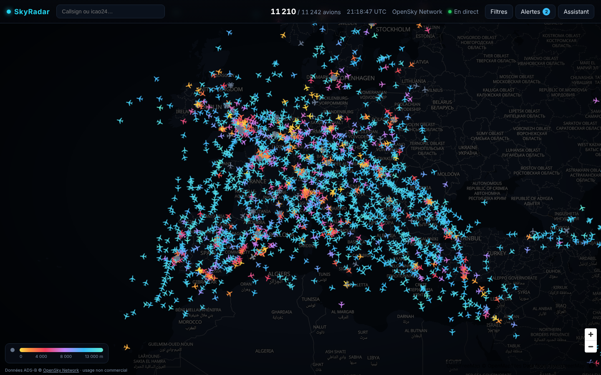
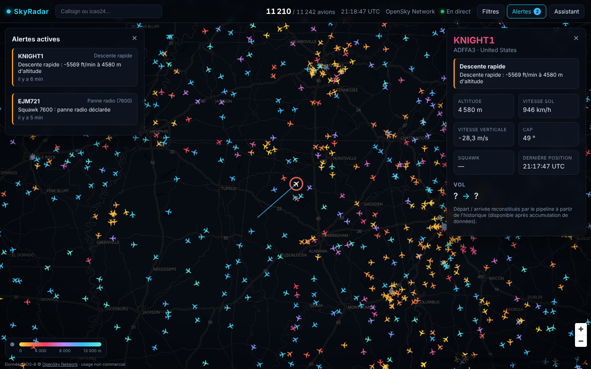
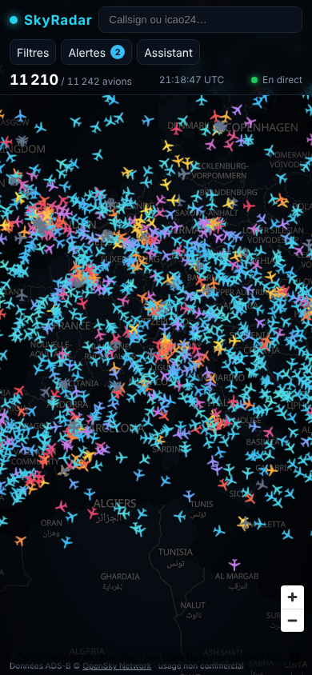
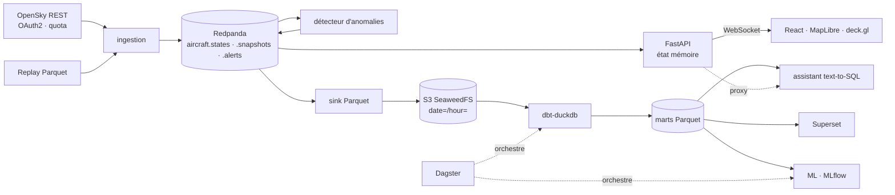
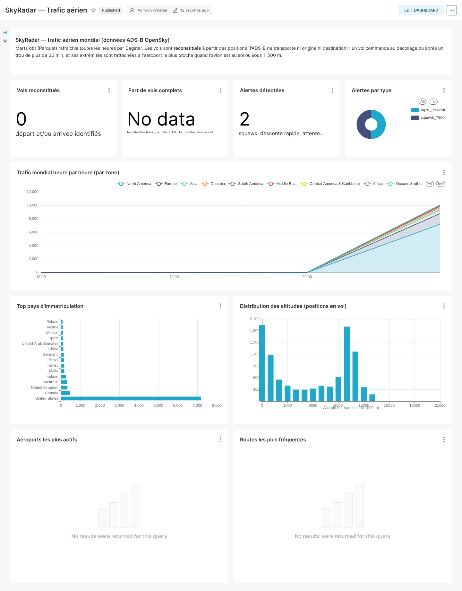

# SkyRadar ✈️ — tous les avions du monde, en temps réel

**SkyRadar affiche en direct les quelque 11 000 avions suivis par le réseau ADS-B OpenSky sur
une carte fluide, et historise chaque position dans un lakehouse (Redpanda → Parquet → dbt →
DuckDB). Ces données alimentent des dashboards, de la détection d'anomalies, des modèles de ML
et un assistant en langage naturel.**
Projet portfolio de bout en bout : ingestion temps réel, streaming, data engineering,
analytics, ML et IA générative.


<sub>Capture réelle (13/10/2026) : 11 242 avions suivis, couleur selon l'altitude, positions
interpolées entre deux snapshots.</sub>

| Fiche avion + alerte détectée en direct | Mobile |
|---|---|
|  |  |

---

## Sommaire
- [Ce que le projet démontre](#ce-que-le-projet-démontre)
- [Architecture](#architecture)
- [Démarrage rapide](#démarrage-rapide)
- [Composants et choix techniques](#composants-et-choix-techniques)
- [État d'avancement](#état-davancement)
- [Limites connues](#limites-connues)
- [Feuille de route](#feuille-de-route)
- [English summary](#english-summary)

## Ce que le projet démontre

| Domaine | Ce qui est construit |
|---|---|
| **Data engineering temps réel** | Client OpenSky OAuth2 avec **intervalle de polling calculé à partir du quota de crédits**, backoff sur les 429, Redpanda (Kafka), contrats d'événements pydantic, sink Parquet *at-least-once* avec commits d'offsets maîtrisés |
| **Lakehouse & analytics engineering** | Parquet partitionné `date=/hour=` sur stockage S3, **dbt-duckdb** (staging incrémental → intermediate → marts), tests dbt, marts en Parquet pour respecter la contrainte mono-écrivain de DuckDB |
| **Orchestration & qualité** | **Dagster** : lake déclaré en *external assets*, tests dbt exposés en *asset checks*, check de fraîcheur, schedules horaire et quotidien, file d'exécution |
| **Reconstitution de vols** | Segmentation des trajectoires et rattachement des extrémités à l'aéroport le plus proche (OurAirports), en SQL, car l'ADS-B ne transporte ni origine ni destination |
| **Détection d'anomalies en streaming** | Squawk 7500/7600/7700, descente rapide, **attente / tourne en rond** (cap cumulé sur fenêtre glissante, plus un critère de confinement robuste aux échantillonnages espacés) |
| **Produit & front** | React + MapLibre + **deck.gl** sur buffers binaires, **interpolation sphérique** des positions, WebSocket au format colonne, responsive |
| **BI** | **Superset** sur DuckDB, dashboard versionné « as code » et importé au démarrage |
| **MLOps / IA** | **MLflow** (tracking des métriques de reconstitution), assistant text-to-SQL avec **garde-fous** sqlglot (SELECT seul, tables en liste blanche, LIMIT forcé, timeout, DuckDB sans accès fichier) |
| **Industrialisation** | Docker multi-stage, healthchecks, profils compose, Makefile, CI GitHub Actions (lint, typage, tests, `dbt build`, build des images, test e2e) |

## Architecture



Détails : [docs/architecture.md](docs/architecture.md) · protocole temps réel :
[docs/websocket-protocol.md](docs/websocket-protocol.md) · décisions :
[docs/adr/](docs/adr/) · plan : [docs/implementation-plan.md](docs/implementation-plan.md).

## Démarrage rapide

Prérequis : Docker (avec Compose v2), `make`, Python 3 ; [uv](https://docs.astral.sh/uv/) et
Node 22 pour le développement.

```bash
cp .env.example .env      # optionnel : make le fait ; renseigner OPENSKY_CLIENT_ID/SECRET
make seed                 # télécharge les données de référence (OurAirports)
make up                   # stack complète (profil "full")
# ou
make up-demo              # carte en direct uniquement (Redpanda, ingestion, API, frontend)
make replay               # démo hors ligne : rejoue data/replay/replay.parquet (ou trafic synthétique)
```

| URL | Service |
|---|---|
| http://localhost:3000 | Carte en direct |
| http://localhost:8000/docs | API (OpenAPI) |
| http://localhost:3001 | Dagster |
| http://localhost:8088 | Superset (admin / mot de passe du `.env`) |
| http://localhost:5000 | MLflow |
| http://localhost:8081 | Console Redpanda |
| http://localhost:8888/buckets/ | Navigateur du lake (filer SeaweedFS) |

Autres commandes : `make record` (enregistre 30 min de données réelles pour le replay),
`make test`, `make lint`, `make dbt-build` (dbt sur un lake de test déterministe),
`make smoke` (tests e2e sur la stack lancée), `make logs S=ingestion`, `make down`, `make clean`.

**Sans aucune clé**, tout fonctionne : OpenSky passe en mode anonyme (un snapshot toutes les
16 min, la carte interpole entre deux snapshots) et l'assistant est désactivé proprement.
**Lancez l'ingestion le plus tôt possible** : la reconstitution des vols et les futurs modèles
de ML s'améliorent avec l'historique accumulé.

### Quota OpenSky : intervalle calculé

Selon la documentation officielle, un appel global à `/states/all` coûte **4 crédits** ; le
quota journalier est de **400** crédits en anonyme, **4 000** avec un compte et **8 000** pour
un feeder actif. Avec 10 % de marge :

| Profil | Intervalle (`POLL_INTERVAL_SECONDS=auto`) | Appels / 24 h | Crédits / 24 h |
|---|---|---|---|
| Anonyme | 960 s | 90 | 360 / 400 |
| Compte (OAuth2) | 96 s | 900 | 3 600 / 4 000 |
| Feeder | 48 s | 1 800 | 7 200 / 8 000 |

Une valeur manuelle trop agressive est automatiquement relevée au minimum sûr. Une bounding
box (`OPENSKY_BBOX`) réduit le coût par appel et donc l'intervalle. Voir
[ADR 0006](docs/adr/0006-opensky-polling.md).

## Composants et choix techniques

| Dossier | Rôle | Choix et compromis |
|---|---|---|
| `libs/common` | Modèles de messages pydantic, Kafka, logging structlog, S3, schémas Arrow | Une seule source de vérité pour les contrats ([ADR 0004](docs/adr/0004-event-contracts.md)) |
| `ingestion/` | `FlightDataSource` (adapter) : `OpenSkySource`, `ReplaySource`, générateur synthétique ; producteur Redpanda ; `/metrics` Prometheus | httpx async ; token OAuth2 mis en cache et renouvelé ; cadence fixe ; replay rebasé sur l'heure courante |
| `api/` | FastAPI : état mémoire, traces, `WS /ws/live`, `/aircraft/{icao24}`, `/alerts`, `/stats/live`, proxy `/assistant/ask` | Pas de *consumer group* (vue diffusée à chaque réplique) ; relecture de 20 min au démarrage ; deltas en colonnes, envoyés au plus une fois par seconde |
| `frontend/` | React, MapLibre (tuiles OpenFreeMap, sans clé), deck.gl | Store hors React, `IconLayer` sur `Float32Array`, *dead reckoning* + fondu de correction ; nginx sert le build et proxifie `/api` (aucun secret côté navigateur) |
| `streaming/` | `parquet_sink` et `anomaly` | At-least-once + noms de fichiers déterministes ([ADR 0005](docs/adr/0005-sink-delivery-semantics.md)) ; règles pures et testées unitairement |
| `pipeline/dbt` | staging → intermediate → marts | Marts en Parquet externes, dbt seul écrivain ([ADR 0003](docs/adr/0003-duckdb-single-writer.md)) ; aucun package dbt externe (tests génériques maison), donc build hors ligne |
| `pipeline/dagster` | Assets dbt, checks, schedules, asset ML | `QueuedRunCoordinator` limité à 1 run (DuckDB mono-écrivain) ; métadonnées dans Postgres |
| `ml/` | Accès en lecture seule aux marts, métriques de reconstitution, tracking MLflow | Le tracking n'interrompt jamais le pipeline (dégradation propre sans MLflow) |
| `assistant/` | Garde-fous SQL, exécution en lecture seule, `/schema` | Défense en profondeur : parsing sqlglot + liste blanche + `LIMIT` + DuckDB `enable_external_access=false` + timeout |
| `dashboards/` | Dashboard Superset « as code » (`build_dashboards.py`) exporté en YAML | Versionné, diffable, importé automatiquement au démarrage de Superset |
| `infra/` | Images MLflow et Superset, init Postgres | Une instance Postgres, une base par outil |

Stockage objet : **SeaweedFS** (compatible S3) remplace MinIO, qui ne publie plus d'images
Docker communautaires ([ADR 0002](docs/adr/0002-object-storage-seaweedfs.md)). Le code reste
générique S3.

### Dashboard Superset


<sub>Capture prise après quelques minutes d'ingestion : le trafic par zone, les pays et les
altitudes sont alimentés par les vraies données. Les tableaux de vols, d'aéroports et de routes
se remplissent après quelques heures d'historique, le temps qu'assez de vols soient
reconstitués.</sub>

## État d'avancement

Le projet est construit en trois étapes : **squelette → tranche verticale → enrichissement**
(voir le [plan](docs/implementation-plan.md)). Les deux premières sont terminées : chaque brique
existe dans une version minimale mais réelle, et une donnée traverse tout le système.

| Critère d'acceptation | État |
|---|---|
| `make up` / `make up-demo` démarrent sans erreur | ✅ vérifié (tous les services *healthy*) |
| Milliers d'avions réels, fluides, fiche + trace au clic | ✅ ~11 000 avions OpenSky, interpolation, fiche, trace |
| Quota OpenSky jamais dépassé sur 24 h | ✅ intervalle calculé, testé, documenté |
| Positions historisées en Parquet partitionné sur S3 | ✅ (SeaweedFS au lieu de MinIO, voir ADR 0002) |
| `dbt build` passe, marts visibles dans Superset | ✅ 10 modèles, 40 tests dbt ; dashboard de 9 graphiques |
| Dagster orchestre dbt, qualité et ML | ✅ assets dbt + asset checks + asset ML ; 🔜 Soda Core |
| Alertes squawk et attente en cercle en direct sur la carte | ✅ (+ descente rapide) |
| Modèles suivis dans MLflow avec baseline | 🟡 tracking en place (qualité de la reconstitution) ; 🔜 ETA LightGBM vs baseline, prévision de trafic |
| Assistant en français, lecture seule, garde-fous | 🟡 garde-fous et exécution sécurisée faits ; 🔜 boucle LLM (Anthropic / Ollama) |
| Démo complète sans OpenSky (replay) | ✅ `make replay` (fichier enregistré ou trafic synthétique) |
| CI verte, README complet | ✅ workflow lint / types / tests / dbt / images / e2e |

## Limites connues

- **Couverture ADS-B** : excellente au-dessus de l'Amérique du Nord et de l'Europe, faible
  au-dessus des océans, de l'Afrique et d'une partie de l'Asie (réseau de récepteurs au sol
  bénévoles). Les « trous » de trajectoire découpent parfois un vol en deux.
- **Pas d'origine ni de destination dans les données** : elles sont **reconstituées**
  (aéroport le plus proche d'une extrémité basse). Un vol qui sort de la couverture avant
  l'atterrissage n'a pas d'arrivée.
- **Quota de l'API** : en anonyme, un snapshot toutes les 16 minutes ; l'interpolation est
  alors une extrapolation qui ignore les virages. Un compte gratuit ramène l'intervalle à 96 s.
- **Données** : OpenSky Network, **usage non commercial et recherche uniquement**
  (<https://opensky-network.org/about/terms-of-use>). Les fichiers enregistrés ne sont pas
  redistribués dans ce dépôt.
- La réécriture horaire d'un mart peut faire échouer une requête qui la chevauche (voir ADR 0003).

## Feuille de route

1. Qualité des données avec **Soda Core** (fraîcheur, volume, téléportation) en asset checks.
2. Reconstitution des vols : dbt incrémental, clustering DBSCAN des extrémités sans aéroport.
3. Anomalies : perte de signal en vol, déroutement (destination habituelle du callsign),
   Isolation Forest sur des features de trajectoire.
4. **ETA** : LightGBM contre une baseline distance / vitesse (MAE, MAPE dans MLflow), activé
   au-delà d'un seuil d'historique ; estimation naïve affichée en attendant.
5. **Prévision de trafic** par zone (Prophet ou statsmodels) contre une baseline saisonnière.
6. **Assistant** : boucle text-to-SQL Anthropic (ou Ollama), outil « état en direct », jeu
   d'évaluation de 20 questions, serveur MCP pour Claude Desktop.
7. Dashboards : performance du modèle d'ETA ; enrichissement avec la base aéronefs OpenSky.
8. Déploiement du profil `demo` (Fly.io ou Render + Cloudflare Pages), compaction des petits
   fichiers Parquet.

---

## English summary

**SkyRadar** is an end-to-end, real-time flight tracking platform built as a data portfolio
project. It ingests live ADS-B state vectors from the OpenSky Network (OAuth2 client
credentials, with a polling interval **derived from the daily credit quota**: 960 s anonymous,
96 s registered, 48 s feeder) and publishes them to **Redpanda**. Downstream:

- a **FastAPI** service keeps the live state in memory and streams column-oriented deltas over
  WebSocket to a **React + MapLibre + deck.gl** map, which renders 11k+ aircraft with
  spherical dead-reckoning interpolation;
- a streaming **anomaly detector** raises emergency squawk, rapid-descent and holding-pattern
  alerts in real time;
- an at-least-once **Parquet sink** lands every position in an S3 lake (SeaweedFS, since MinIO
  no longer ships community images), modelled with **dbt-duckdb** (incremental staging,
  flight reconstruction, marts written as Parquet to respect DuckDB's single-writer
  constraint) and orchestrated by **Dagster** (dbt tests as asset checks, freshness check,
  MLflow-tracked ML asset);
- **Superset** dashboards are versioned as code; a guarded **text-to-SQL assistant**
  (sqlglot allow-listing, forced LIMIT, timeout, sandboxed read-only DuckDB) is in place, with
  its LLM loop next on the roadmap.

Quick start: `cp .env.example .env && make seed && make up` (or `make up-demo`, or `make
replay` for a fully offline demo). Everything runs without any API key. Status: skeleton and
vertical slice done and verified end to end on real data; ML models (ETA, forecasting,
Isolation Forest), Soda Core checks and the LLM assistant loop are the next iteration.

OpenSky data is for **non-commercial / research use only**.
