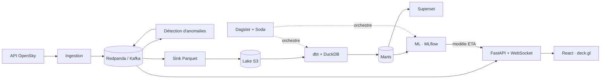

# SkyRadar ✈️ — le trafic aérien mondial en temps réel

**[▶ Démo en ligne : skyradar.duckdns.org](https://skyradar.duckdns.org)**

SkyRadar suit en direct les quelque 14 000 avions captés par le réseau ADS-B OpenSky, les
affiche sur une carte fluide et historise chaque position dans un lakehouse qui alimente des
dashboards, de la détection d'anomalies et des modèles de machine learning.

Projet personnel de bout en bout, de l'ingestion temps réel jusqu'au déploiement :
**data engineering**, **analytics engineering**, **machine learning** et **développement
full-stack**.


<sub>Enregistrement réel sur la démo (accéléré) : carte en direct, vol Bristol → Bodrum et sa
trajectoire, puis arrivées de Paris-CDG avec la météo de l'aéroport.</sub>

## Fonctionnalités

- **Carte en direct** : ~14 000 avions, positions interpolées entre deux mises à jour,
  couleur selon l'altitude.
- **Fiche vol** : compagnie, type d'appareil, départ → destination, heures, progression et
  heure d'arrivée prédite par un modèle de ML.
- **Vue aéroport** : arrivées, départs, avions au sol et météo en direct, pour ~6 000
  aéroports.
- **Alertes** : urgences (squawk 7700 / 7500), descentes rapides, pertes de signal,
  déroutements et trajectoires atypiques, détectés en streaming et en batch.

## Architecture



## Ce que le projet démontre

| Domaine | Réalisation |
|---|---|
| **Streaming temps réel** | Ingestion OpenSky (OAuth2, cadence calculée selon le quota d'appels), Redpanda (Kafka), API FastAPI qui diffuse les positions en WebSocket, détection d'anomalies en streaming |
| **Data engineering** | Lake Parquet partitionné sur stockage S3, écriture *at-least-once*, compaction et rétention automatiques |
| **Analytics engineering** | dbt + DuckDB : 25 modèles et 77 tests, reconstitution des vols (départ, arrivée) à partir des seules positions brutes |
| **Orchestration et qualité** | Dagster (assets, planification), contrats de données Soda Core, 91 contrôles qualité |
| **Machine learning** | Heure d'arrivée (LightGBM contre une baseline physique), prévision du trafic, détection de vols atypiques (Isolation Forest), clustering (DBSCAN), suivi dans MLflow |
| **BI** | 3 dashboards Superset versionnés « as code » |
| **Front-end** | React, TypeScript, MapLibre et deck.gl (14 000 objets animés en direct), responsive |
| **DevOps** | Docker Compose, CI GitHub Actions (lint, typage, tests, dbt, tests navigateur Playwright), supervision Prometheus / Grafana, déployé sur une VM cloud derrière Caddy (HTTPS) |

## Aperçu

| Fiche vol | Tableau d'aéroport |
|---|---|
|  |  |
| **Dashboard Superset** | **Orchestration Dagster** |
|  |  |

## Stack technique

Python · FastAPI · Redpanda (Kafka) · dbt · DuckDB · Dagster · Soda Core · LightGBM ·
scikit-learn · MLflow · Superset · React · TypeScript · deck.gl · MapLibre · Docker ·
GitHub Actions · Prometheus · Grafana

## Lancer le projet

```bash
cp .env.example .env   # identifiants OpenSky (optionnels)
make seed              # référentiels : aéroports, base aéronefs
make up                # stack complète, carte sur http://localhost:3000
```

`make replay` lance une démo hors ligne sur des données enregistrées.
Plus de détails : [architecture](docs/architecture.md) · [déploiement](docs/deployment.md) ·
[décisions techniques (ADR)](docs/adr/).

<sub>Données : OpenSky Network (usage non commercial), OurAirports, OpenFlights, Open-Meteo.</sub>
