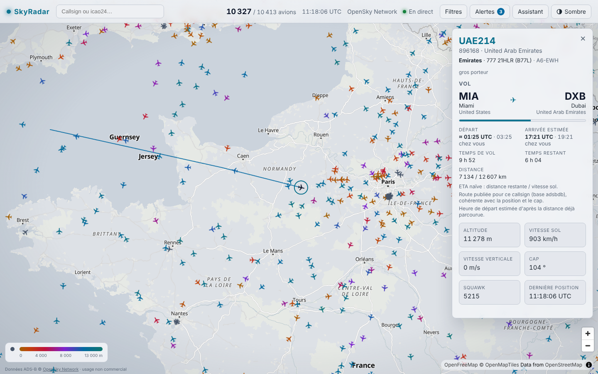
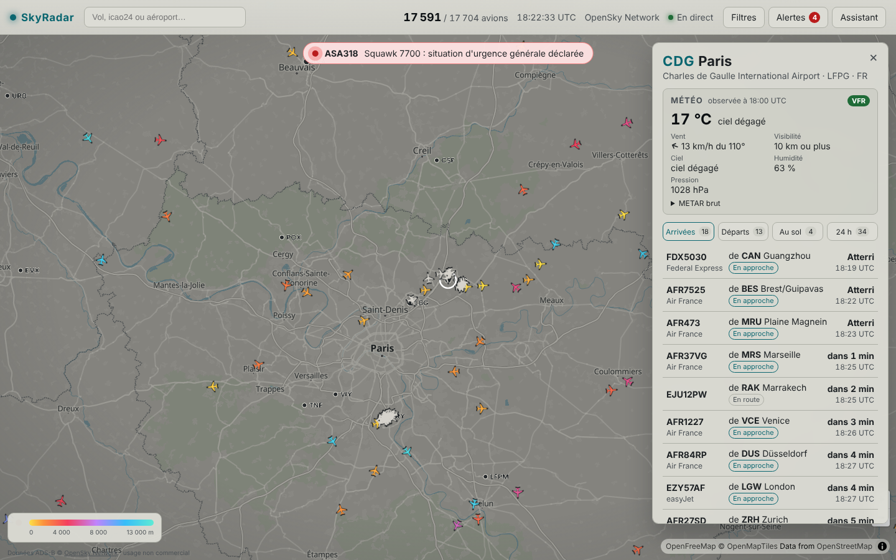
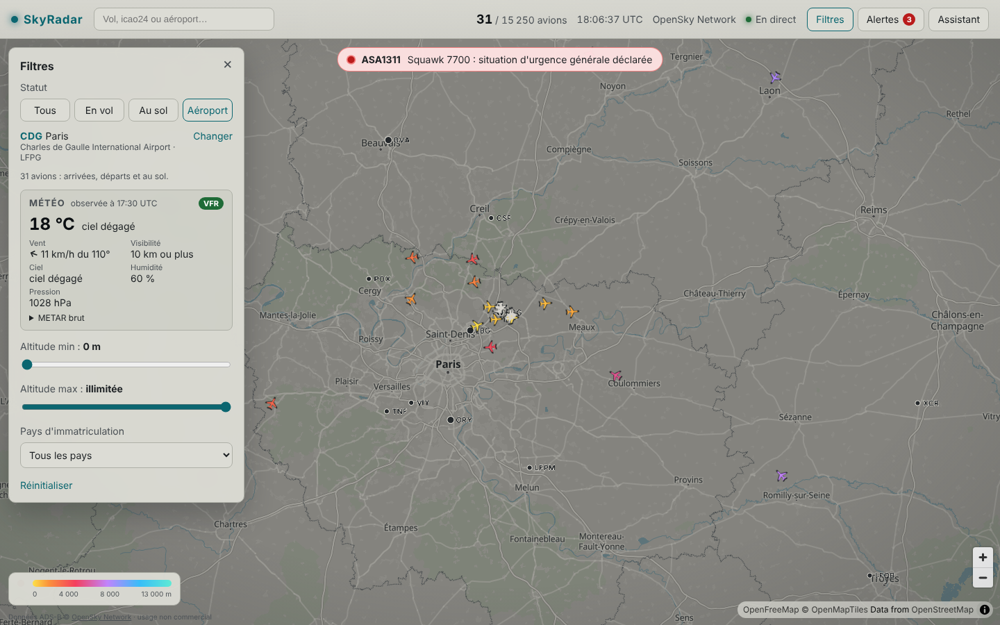
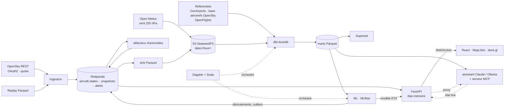
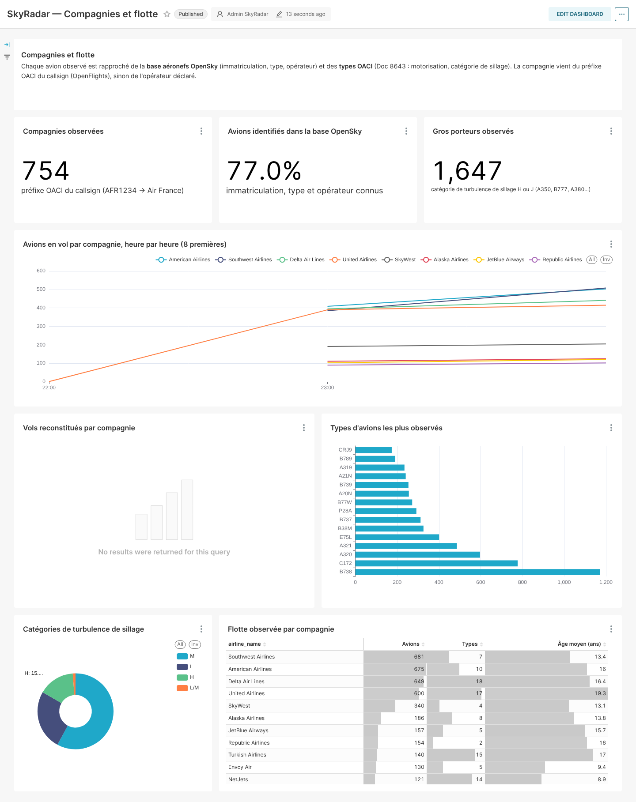
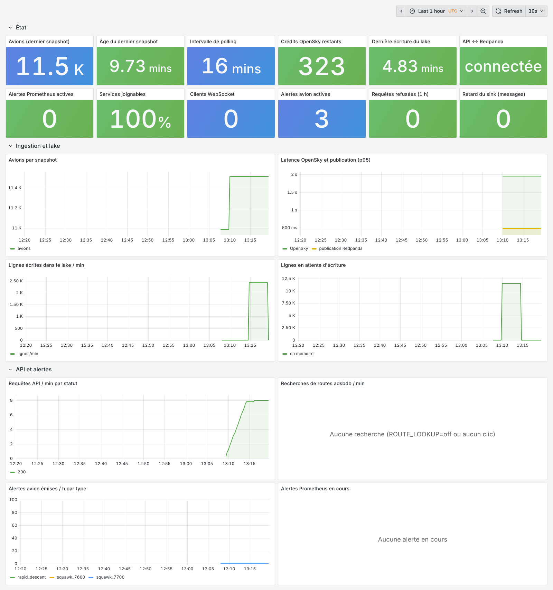

# SkyRadar ✈️ — tous les avions du monde, en temps réel

**SkyRadar affiche en direct les quelque 11 000 avions suivis par le réseau ADS-B OpenSky sur
une carte fluide, et historise chaque position dans un lakehouse (Redpanda → Parquet → dbt →
DuckDB). Ces données alimentent des dashboards, de la détection d'anomalies, des modèles de ML
et un assistant en langage naturel.**
Projet portfolio de bout en bout : ingestion temps réel, streaming, data engineering,
analytics, ML et IA générative.


<sub>Enregistrement réel (14/10/2026, 18 h UTC, accéléré 3×) : ~15 000 avions suivis, couleur
selon l'altitude ; zoom, recherche d'EZY96XD (Birmingham → Faro) puis fiche et trajet
([capture fixe](docs/images/map.png)).</sub>

| Fiche avion : compagnie, type, départ → destination, heures, progression, trajet | Mobile |
|---|---|
|  |  |

<sub>Carte en tons doux (terres gris-olive, eau bleu ardoise), avions cernés de sombre pour rester
lisibles sur tous les fonds. Le trajet part de l'aéroport de départ : en pointillés la partie
estimée (avion repéré déjà en vol), en trait plein la partie observée. Une alerte détectée en
direct : [capture](docs/images/aircraft-alert.png).</sub>


<sub>**Vue aéroport** : un clic sur un aéroport (ou la recherche de son code, `CDG`, `LFPG`, ou
d'une ville) ouvre son tableau en direct : arrivées (provenance, heure d'arrivée estimée),
départs (destination, heure de décollage), avions au sol, et les mouvements reconstitués des
dernières 24 h. Chaque ligne ouvre la fiche de l'avion.</sub>


<sub>**Filtre aéroport** (Filtres → Aéroport) : la carte ne garde que les avions de l'aéroport
choisi (arrivées, départs, au sol) et affiche sa **météo** : dernier bulletin METAR décodé
(température, vent, visibilité, nuages, humidité, pression, catégorie de vol VFR / IFR).</sub>

---

## Sommaire
- [Ce que le projet démontre](#ce-que-le-projet-démontre)
- [Architecture](#architecture)
- [Démarrage rapide](#démarrage-rapide)
- [Composants et choix techniques](#composants-et-choix-techniques)
- [État d'avancement](#état-davancement)
- [Limites connues](#limites-connues)
- [Feuille de route](#feuille-de-route)
- [English summary](#english-summary)

## Ce que le projet démontre

| Domaine | Ce qui est construit |
|---|---|
| **Data engineering temps réel** | Client OpenSky OAuth2 avec **intervalle de polling calculé à partir du quota de crédits**, backoff sur les 429, Redpanda (Kafka), contrats d'événements pydantic, sink Parquet *at-least-once* avec commits d'offsets maîtrisés |
| **Lakehouse & analytics engineering** | Parquet partitionné `date=/hour=` sur stockage S3, **dbt-duckdb** (staging incrémental → intermediate → marts), tests dbt, marts en Parquet pour respecter la contrainte mono-écrivain de DuckDB |
| **Orchestration & qualité** | **Dagster** : lake déclaré en *external assets*, tests dbt et **contrats Soda Core** (fraîcheur, volume, téléportation) exposés en *asset checks*, schedules horaire / quotidien / maintenance, compaction des petits fichiers Parquet |
| **Reconstitution de vols** | Segmentation des trajectoires et rattachement des extrémités à l'aéroport le plus proche (OurAirports), en SQL, car l'ADS-B ne transporte ni origine ni destination ; **DBSCAN** des décollages / atterrissages hors référentiel (terrains, héliports) |
| **Enrichissement** | **Base aéronefs OpenSky** (520 000 avions : immatriculation, type, opérateur), types OACI (Doc 8643 : catégorie de sillage), compagnies OpenFlights, routes publiées des callsigns (**adsbdb**, contrôlées contre la position), **vent en altitude** Open-Meteo (250 hPa) |
| **Détection d'anomalies** | En streaming : squawk 7500/7600/7700, descente rapide, **attente / tourne en rond**, **perte de signal en zone couverte** (position extrapolée + couverture des récepteurs). En batch : **déroutements** (destination habituelle du callsign) et vols atypiques (**Isolation Forest** expliqué) |
| **Produit & front** | React + MapLibre + **deck.gl** sur buffers binaires, **interpolation sphérique** des positions, WebSocket au format colonne, responsive, fond de carte en tons doux et avions cernés (contrastes de 3:1 minimum vérifiés par des tests), **tableau des arrivées / départs de chaque aéroport** (6 000 aéroports affichés selon le zoom), **filtre aéroport avec sa météo** (METAR décodé) |
| **BI** | **Superset** sur DuckDB : dashboards *Trafic aérien*, *Modèles ML* et *Compagnies et flotte* versionnés « as code » et importés au démarrage |
| **Machine learning** | **ETA LightGBM** qui corrige une baseline physique (MAE comparée dans MLflow, barrière de promotion, servie par l'API), avec le vent arrière en altitude évalué par ablation ; **prévision du trafic** par zone (Holt-Winters contre naïf saisonnier) ; registry et historique des métriques dans **MLflow** ([ADR 0008](docs/adr/0008-ml-models.md)) |
| **IA générative** | **Assistant en français** : boucle d'outils Claude (text-to-SQL + état en direct) ou modèle local Ollama, **garde-fous** sqlglot (SELECT seul, liste blanche, LIMIT forcé, timeout, DuckDB sans accès fichier), jeu d'évaluation de 22 questions suivi dans **MLflow** (précision par type, empreinte du prompt), **serveur MCP** pour Claude Desktop |
| **Exploitation** | **Prometheus + Grafana + Alertmanager** : chaque service expose ses métriques, dashboard *Supervision* provisionné, **8 règles d'alerte testées unitairement** (`promtool test rules`) : ingestion arrêtée, lake plus écrit, carte figée, retard du sink… ; **rétention** du lake brut (30 jours) et de l'historique de l'entrepôt (180 jours), ancrée sur les données et non sur l'horloge |
| **Industrialisation** | Docker multi-stage, healthchecks, profils compose, Makefile, CI GitHub Actions (lint, typage, tests, `dbt build`, ML et éval de l'assistant sur données de test, build des images, règles d'alerte, test e2e jusqu'au navigateur avec **Playwright**), [guide de déploiement](docs/deployment.md) (VM + Caddy, ou Cloudflare Pages + Fly.io + Kafka managé) avec **limites de débit** par client, budget journalier de l'assistant et outils d'administration derrière un mot de passe |

## Architecture



Détails : [docs/architecture.md](docs/architecture.md) · protocole temps réel :
[docs/websocket-protocol.md](docs/websocket-protocol.md) · décisions :
[docs/adr/](docs/adr/) · plan : [docs/implementation-plan.md](docs/implementation-plan.md).

## Démarrage rapide

Prérequis : Docker (avec Compose v2), `make`, Python 3 ; [uv](https://docs.astral.sh/uv/) et
Node 22 pour le développement.

```bash
cp .env.example .env      # optionnel : make le fait ; renseigner OPENSKY_CLIENT_ID/SECRET
make seed                 # télécharge les données de référence (OurAirports)
make up                   # stack complète (profil "full")
# ou
make up-demo              # carte en direct uniquement (Redpanda, ingestion, API, frontend)
make replay               # démo hors ligne : rejoue data/replay/replay.parquet (ou trafic synthétique)
```

**Windows (PowerShell, sans `make`)** : Docker Desktop doit être lancé. Chaque cible `make`
correspond à des commandes simples :

```powershell
Copy-Item .env.example .env                          # une seule fois
python scripts/seed_reference_data.py                # make seed (aéroports, base aéronefs, compagnies)
docker compose --profile full up -d --build --wait   # make up
docker compose --profile demo up -d --build --wait   # make up-demo
$env:SOURCE="replay"; docker compose --profile demo up -d --build --wait   # make replay
docker compose --profile full --profile demo down    # make down
```

Avec WSL2 (Ubuntu), les commandes `make` fonctionnent telles quelles.

| URL | Service |
|---|---|
| http://localhost:3000 | Carte en direct |
| http://localhost:8000/docs | API (OpenAPI) |
| http://localhost:3001 | Dagster |
| http://localhost:8088 | Superset (admin / mot de passe du `.env`) |
| http://localhost:5000 | MLflow |
| http://localhost:8081 | Console Redpanda |
| http://localhost:8888/buckets/ | Navigateur du lake (filer SeaweedFS) |
| http://localhost:3002 | Grafana : dashboard *Supervision* (admin / mot de passe du `.env`) |
| http://localhost:9090 | Prometheus (cibles, règles d'alerte) |

Autres commandes : `make record` (enregistre 30 min de données réelles pour le replay),
`make test`, `make lint`, `make dbt-build` (dbt sur un lake de test déterministe),
`make seed` (référentiels : aéroports, base aéronefs OpenSky ~95 Mo, compagnies ;
`SKYRADAR_SKIP_AIRCRAFT_DB=1` pour sauter la base aéronefs),
`make eval-assistant` (évaluation de l'assistant ; `DRY=1` pour ne vérifier que les requêtes
de référence, sans appel au LLM), `make smoke` (tests e2e sur la stack lancée),
`make test-ui` (test Playwright de la carte dans un navigateur), `make test-monitoring`
(configurations Prometheus / Alertmanager et tests des règles d'alerte),
`make logs S=ingestion`, `make down`, `make clean`.

**Sans aucune clé**, tout fonctionne : OpenSky passe en mode anonyme (un snapshot toutes les
16 min, la carte interpole entre deux snapshots) et l'assistant est désactivé proprement
(réponse 503 explicite). Avec `ANTHROPIC_API_KEY` l'assistant utilise Claude ; avec
`OLLAMA_BASE_URL` un modèle local, gratuit (`ollama pull qwen2.5:7b` d'abord, le nom doit
correspondre exactement à `OLLAMA_MODEL`, voir `ollama list`). L'assistant s'ouvre dans une
barre de discussion à droite de la carte, garde le contexte des derniers échanges (« et
hier ? ») et ne répond qu'aux questions sur le trafic aérien et SkyRadar.
**Lancez l'ingestion le plus tôt possible** : la reconstitution des vols et les futurs modèles
de ML s'améliorent avec l'historique accumulé.

### Quota OpenSky : intervalle calculé

Selon la documentation officielle, un appel global à `/states/all` coûte **4 crédits** ; le
quota journalier est de **400** crédits en anonyme, **4 000** avec un compte et **8 000** pour
un feeder actif. Avec 10 % de marge :

| Profil | Intervalle (`POLL_INTERVAL_SECONDS=auto`) | Appels / 24 h | Crédits / 24 h |
|---|---|---|---|
| Anonyme | 960 s | 90 | 360 / 400 |
| Compte (OAuth2) | 96 s | 900 | 3 600 / 4 000 |
| Feeder | 48 s | 1 800 | 7 200 / 8 000 |

Une valeur manuelle trop agressive est automatiquement relevée au minimum sûr. Une bounding
box (`OPENSKY_BBOX`) réduit le coût par appel et donc l'intervalle. Voir
[ADR 0006](docs/adr/0006-opensky-polling.md).

## Composants et choix techniques

| Dossier | Rôle | Choix et compromis |
|---|---|---|
| `libs/common` | Modèles de messages pydantic, Kafka, logging structlog, S3, schémas Arrow | Une seule source de vérité pour les contrats ([ADR 0004](docs/adr/0004-event-contracts.md)) |
| `ingestion/` | `FlightDataSource` (adapter) : `OpenSkySource`, `ReplaySource`, générateur synthétique ; producteur Redpanda ; `/metrics` Prometheus | httpx async ; token OAuth2 mis en cache et renouvelé ; cadence fixe ; replay rebasé sur l'heure courante |
| `api/` | FastAPI : état mémoire, traces, `WS /ws/live`, `/aircraft/{icao24}` (compagnie, type et immatriculation, **départ → destination**, heures de départ et d'arrivée estimée, temps de vol, progression, **ETA**), `/live/region`, `/airports` et `/airports/{icao}/board` (arrivées, départs et avions au sol en direct, 24 dernières heures), `/alerts`, `/stats/live`, proxy `/assistant/ask`, `/metrics` | Pas de *consumer group* (vue diffusée à chaque réplique) ; relecture de 20 min au démarrage ; deltas en colonnes, envoyés au plus une fois par seconde ; marts et modèle ETA rechargés à chaud ; recherche dans la base aéronefs par requête ponctuelle DuckDB mise en cache (~15 ms) ; route publiée du callsign (adsbdb, en cache) acceptée seulement si elle est cohérente avec la position et le cap, sinon historique de SkyRadar ; tableau d'aéroport : recherches de routes limitées aux avions à moins de 150 km (les plus proches d'abord, 40 par requête, 6 en parallèle, 300 / min au total vers adsbdb), géométrie d'approche ou de montée à défaut |
| `frontend/` | React, MapLibre (tuiles OpenFreeMap, sans clé), deck.gl | Store hors React, `IconLayer` sur `Float32Array`, *dead reckoning* + fondu de correction ; nginx sert le build et proxifie `/api` (aucun secret côté navigateur) |
| `streaming/` | `parquet_sink` et `anomaly` | At-least-once + noms de fichiers déterministes ([ADR 0005](docs/adr/0005-sink-delivery-semantics.md)) ; règles pures et testées unitairement ; la perte de signal attend deux snapshots manquants et ne s'active qu'avec un polling authentifié (calibrée sur données réelles) |
| `pipeline/dbt` | staging → intermediate → marts, features ML | 25 modèles et 77 tests, marts en Parquet externes, dbt seul écrivain ([ADR 0003](docs/adr/0003-duckdb-single-writer.md)) ; aucun package dbt externe (tests génériques maison), donc build hors ligne ; filtrage des positions aberrantes (« téléportations » ADS-B) avant la segmentation des vols ; référentiels optionnels (relation typée vide si un fichier manque) |
| `pipeline/dagster` | Assets dbt, asset checks dbt + Soda, vent en altitude (Open-Meteo, une fois par jour), assets ML (entraînement quotidien, scoring horaire), compaction et rétention du lake | `QueuedRunCoordinator` limité à 1 run (DuckDB mono-écrivain) ; métadonnées dans Postgres |
| `data_quality/` | Contrats **Soda Core** v4 (`raw_aircraft_states`, `fct_flights`) | Déclaratifs, exécutés sur une connexion DuckDB en mémoire ([ADR 0007](docs/adr/0007-data-quality-tool.md)) |
| `ml/` | ETA, prévision de trafic, Isolation Forest, DBSCAN des extrémités hors aéroport, qualité de la reconstitution | Seuils d'historique (`skipped` tant que les données manquent), baseline systématique, écriture atomique des sorties, tracking MLflow non bloquant ([ADR 0008](docs/adr/0008-ml-models.md)) |
| `assistant/` | Boucle d'outils Claude (*tool runner* du SDK Anthropic) ou Ollama, garde-fous SQL, serveur MCP, jeu d'évaluation | Défense en profondeur : parsing sqlglot + liste blanche + `LIMIT` + DuckDB `enable_external_access=false` + timeout ; le LLM ne voit que des outils ([docs/mcp.md](docs/mcp.md)) |
| `dashboards/` | Dashboards Superset « as code » (`build_dashboards.py`) exportés en YAML | Versionnés, diffables, importés automatiquement au démarrage de Superset |
| `deploy/` | Caddy, surcharge compose de production, configurations Fly.io | Voir [docs/deployment.md](docs/deployment.md) |
| `infra/` | Images MLflow et Superset, init Postgres, supervision (`infra/monitoring` : Prometheus, règles d'alerte et leurs tests, Alertmanager, Grafana provisionné) | Une instance Postgres, une base par outil ; métriques en *pull*, aucune dépendance des services envers la supervision |

Stockage objet : **SeaweedFS** (compatible S3) remplace MinIO, qui ne publie plus d'images
Docker communautaires ([ADR 0002](docs/adr/0002-object-storage-seaweedfs.md)). Le code reste
générique S3.

### Dashboards Superset


<sub>*Trafic aérien*, sur les données réelles après quelques minutes d'ingestion : le trafic
par zone, les pays et les altitudes sont alimentés tout de suite ; les tableaux de vols,
d'aéroports et de routes se remplissent après quelques heures d'historique.</sub>


<sub>*Compagnies et flotte*, sur les données réelles (14/10/2026) : 74 % des ~24 000 avions
observés sont identifiés dans la base OpenSky (type, immatriculation), la compagnie vient du
callsign ; 4 300 vols reconstitués. Le creux de la courbe horaire (00 h - 09 h UTC) est une
interruption de l'ingestion dans l'environnement de démonstration, pas une absence de trafic.</sub>


<sub>*Modèles ML* : MAE de l'ETA contre la baseline, historique des métriques, trafic observé
et prévu, vols atypiques, déroutements. **Capture sur le lake de test synthétique** (les
modèles ne s'entraînent sur les données réelles qu'après assez d'historique) : ces chiffres
illustrent le dashboard, pas la performance en conditions réelles.</sub>

### Orchestration


<sub>Groupes d'assets Dagster : lake brut (dont le vent en altitude) → modèles dbt (91 asset
checks dbt et Soda, tous verts sur les données réelles) → scoring ML horaire, entraînement
quotidien, et maintenance (compaction puis rétention du lake).</sub>

### Supervision


<sub>Dashboard *Supervision* (Grafana, profil `full`) sur la stack réelle : avions par
snapshot, âge du dernier snapshot, crédits OpenSky, écritures du lake, retard du sink,
requêtes de l'API et alertes en cours. Les règles d'alerte (Prometheus) préviennent quand
l'ingestion s'arrête, que le lake n'est plus écrit ou que la carte se fige ; Alertmanager
est livré avec un exemple de route Slack à activer.</sub>

## État d'avancement

Le projet a été construit en trois étapes : **squelette → tranche verticale → enrichissement**
(voir le [plan](docs/implementation-plan.md)). Les trois sont faites ; tout ce qui suit a été
vérifié sur la stack lancée avec de vraies données OpenSky, sauf mention contraire.

| Critère d'acceptation | État |
|---|---|
| `make up` / `make up-demo` démarrent sans erreur | ✅ tous les services *healthy* |
| Milliers d'avions réels, fluides, fiche + trace au clic | ✅ ~11 000 avions OpenSky, interpolation, fiche (compagnie, type, départ, destination probable, ETA), trace |
| Quota OpenSky jamais dépassé sur 24 h | ✅ intervalle calculé, testé, documenté |
| Positions historisées en Parquet partitionné sur S3 | ✅ (SeaweedFS au lieu de MinIO, voir ADR 0002) ; compaction quotidienne des petits fichiers (un fichier par heure) |
| `dbt build` passe, marts visibles dans Superset | ✅ 25 modèles et 77 tests dbt (lake de test et données réelles) ; 3 dashboards (25 graphiques) |
| Dagster orchestre dbt, qualité et ML | ✅ assets dbt + 91 asset checks (77 tests dbt + 14 checks Soda Core) + assets ML + vent + compaction ; 3 schedules |
| Alertes squawk et attente en cercle en direct sur la carte | ✅ (+ descente rapide, perte de signal, déroutement, vol atypique) |
| Modèles suivis dans MLflow avec baseline | ✅ ETA LightGBM vs distance / vitesse, prévision Holt-Winters vs naïf saisonnier, Isolation Forest ; 🟡 vérifié sur le lake de test, sur données réelles ils attendent l'historique minimal |
| Assistant en français, lecture seule, garde-fous | ✅ boucle d'outils Claude ou Ollama, garde-fous testés, serveur MCP, éval suivie dans MLflow ; 🟡 éval des 22 questions vérifiée côté requêtes de référence (`DRY=1`), l'éval complète demande une clé API |
| Démo complète sans OpenSky (replay) | ✅ `make replay` (fichier enregistré ou trafic synthétique) |
| CI verte, README complet | ✅ workflow lint / types / tests / dbt / ML / éval / images / règles d'alerte / e2e (smoke + Playwright) |
| Démo publique sûre | ✅ seuls 80/443 publiés, limites de débit par client (assistant, fiche avion, WebSocket), budget journalier de l'assistant, outils d'admin derrière un mot de passe (vérifié avec Caddy en local) |
| Supervision et rétention | ✅ Prometheus / Grafana / Alertmanager, 8 règles d'alerte testées ; rétention du lake (30 j) et de l'entrepôt (180 j) |
| Vue aéroport | ✅ tableau en direct (arrivées, départs, sol) et 24 dernières heures ; vérifié sur CDG, Heathrow et JFK en direct, et en CI sur le trafic synthétique |

## Limites connues

- **Couverture ADS-B** : excellente au-dessus de l'Amérique du Nord et de l'Europe, faible
  au-dessus des océans, de l'Afrique et d'une partie de l'Asie (réseau de récepteurs au sol
  bénévoles). Les « trous » de trajectoire découpent parfois un vol en deux.
- **Pas d'origine ni de destination dans les données** : elles sont **reconstituées**
  (aéroport le plus proche d'une extrémité basse). Un vol qui sort de la couverture avant
  l'atterrissage n'a pas d'arrivée.
- **Quota de l'API** : en anonyme, un snapshot toutes les 16 minutes ; l'interpolation est
  alors une extrapolation qui ignore les virages. Un compte gratuit ramène l'intervalle à 96 s.
- **Données** : OpenSky Network (positions et base aéronefs), **usage non commercial et
  recherche uniquement** (<https://opensky-network.org/about/terms-of-use>) ; OpenFlights
  (compagnies, ODbL) ; Open-Meteo (vent, CC BY 4.0) ; aviationweather.gov / NOAA (METAR des
  aéroports, domaine public, `WEATHER_LOOKUP=off` pour le couper) ; OurAirports (domaine public) ; adsbdb
  (routes et avions, interrogé à la demande par l'API, `ROUTE_LOOKUP=off` pour le couper).
  Aucun de ces fichiers n'est redistribué dans ce dépôt : `make seed` les télécharge.
- **Tableau d'aéroport** : l'ADS-B ne dit pas où va un avion ; les arrivées et départs
  viennent des routes publiées (vérifiées), des décollages observés et de l'historique, et
  à défaut de la géométrie (bas, proche, en descente vers l'aéroport). Un avion sans route
  connue qui survole la zone n'est pas listé, et en mode anonyme (un snapshot toutes les
  16 min) une bonne partie des arrivées affichées a déjà atterri : le tableau l'indique.
  Beaucoup d'aéroports ne relaient pas les avions au sol.
- **Routes publiées** : elles viennent d'une base communautaire (adsbdb) et un callsign peut
  être réutilisé ; elles ne sont affichées que si la position et le cap de l'avion sont
  cohérents avec elles (sur 80 vols de ligne en direct : 85 % ont une route cohérente, les
  autres n'en ont pas). Sans décollage observé, l'heure de départ est **estimée** d'après la
  distance parcourue et signalée comme telle.
- **Base aéronefs** : l'instantané public d'OpenSky date d'avril 2024 ; les avions livrés
  depuis n'y figurent pas (environ un avion observé sur quatre n'est pas identifié).
- **Vent** : grille de 10° au niveau 250 hPa (~FL340), adaptée à la croisière seulement ;
  sur le lake de test synthétique (vols sans vent) l'ablation ne montre logiquement aucun
  gain, le gain réel se mesurera avec l'historique.
- La réécriture horaire d'un mart peut faire échouer une requête qui la chevauche (voir ADR 0003).
- **Perte de signal** : en mode anonyme (un snapshot toutes les 16 min), un avion disparu a
  très souvent simplement atterri ; rejouée sur des données réelles, la règle produisait plus
  de 150 alertes par snapshot. Elle ne s'active donc qu'avec un polling authentifié (96 s ou
  48 s) et n'a pas encore pu être observée sur données réelles à cette cadence.
- **Modèles** : les métriques publiées ici viennent du lake de test ; sur données réelles,
  l'ETA dépend de la qualité de la reconstitution (arrivées manquantes hors couverture).

## Feuille de route

1. Ponctualité : nécessite des horaires programmés, absents de l'ADS-B (source à trouver).
2. Rattacher les vols aux clusters DBSCAN récurrents comme pseudo-aéroports.
3. Prévision par aéroport (mouvements horaires) en plus de la prévision par zone.
4. Vent le long de la route restante (et non au seul point courant) pour l'ETA.

---

## English summary

**SkyRadar** is an end-to-end, real-time flight tracking platform built as a data portfolio
project. It ingests live ADS-B state vectors from the OpenSky Network (OAuth2 client
credentials, with a polling interval **derived from the daily credit quota**: 960 s anonymous,
96 s registered, 48 s feeder) and publishes them to **Redpanda**. Downstream:

- a **FastAPI** service keeps the live state in memory and streams column-oriented deltas over
  WebSocket to a **React + MapLibre + deck.gl** map, which renders 11k+ aircraft with
  spherical dead-reckoning interpolation on a muted basemap; the aircraft panel
  shows origin and destination (published route from adsbdb, checked against the live
  position and track, else SkyRadar's own history), departure and estimated arrival times,
  flight progress and an **ETA**, plus the airline, aircraft type and registration
  from the OpenSky aircraft database (520k aircraft) and OpenFlights; clicking an airport
  (or searching its code) opens its **live arrivals / departures board** with the last
  24 hours of reconstructed movements, and an airport filter keeps only that airport's
  aircraft on the map with its current weather (decoded METAR);
- a streaming **anomaly detector** raises emergency squawk, rapid-descent, holding-pattern
  and signal-loss alerts (the latter calibrated on real data: it waits for two missing
  snapshots and only runs with authenticated polling);
- an at-least-once **Parquet sink** lands every position in an S3 lake (SeaweedFS, since MinIO
  no longer ships community images), modelled with **dbt-duckdb** (25 models: incremental
  staging, ADS-B glitch filtering, flight reconstruction, marts and ML features written as
  Parquet to respect DuckDB's single-writer constraint) and orchestrated by **Dagster**
  (dbt tests and **Soda Core** contracts as asset checks, hourly scoring, daily training,
  lake compaction and retention: 30 days of raw data, 180 days of warehouse history);
- **operations**: Prometheus metrics on every service, a provisioned Grafana dashboard and
  8 alert rules unit-tested with `promtool` (ingestion stalled, lake not written, stale live
  map, sink lag…); a public demo is protected by per-client rate limits, a daily assistant
  budget and password-protected admin tools; a Playwright browser test runs in CI;
- **ML**, tracked in **MLflow** against explicit baselines: a LightGBM ETA model that learns a
  correction of the physics baseline (served by the API only if it beats it), with the
  upper-air tail wind (Open-Meteo, 250 hPa) evaluated by ablation, Holt-Winters traffic
  forecasting vs seasonal naive, an explained Isolation Forest and diversion detection
  (both published as alerts), and DBSCAN clustering of take-offs / landings far from any
  known airport;
- **Superset** dashboards (traffic, ML models, airlines and fleet) are versioned as code;
- a French-speaking **assistant** runs a Claude tool loop (or a local Ollama model) over
  guarded text-to-SQL (sqlglot allow-listing, forced LIMIT, timeout, sandboxed read-only
  DuckDB) and live-state tools, with a 22-question eval set tracked in MLflow and an
  **MCP server** for Claude Desktop.

Quick start: `cp .env.example .env && make seed && make up` (or `make up-demo`, or `make
replay` for a fully offline demo). Everything runs without any API key (the assistant is then
disabled cleanly). Deployment: [docs/deployment.md](docs/deployment.md). Status: all three
stages (skeleton, vertical slice, enrichment) are done and verified on real data; model
metrics shown come from the deterministic test lake until enough real history accumulates.

OpenSky data is for **non-commercial / research use only**.
