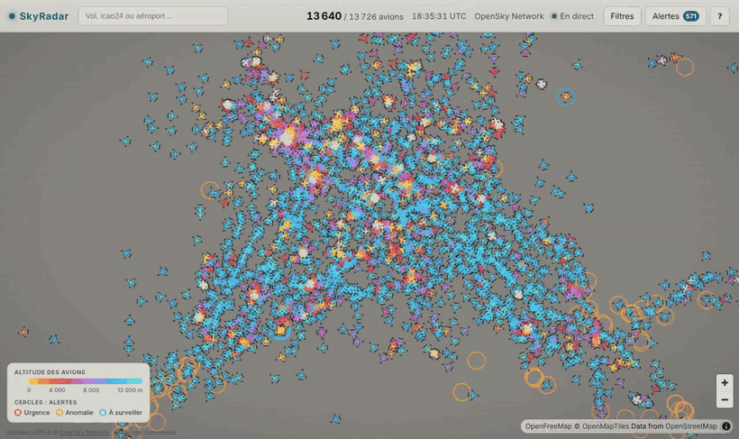
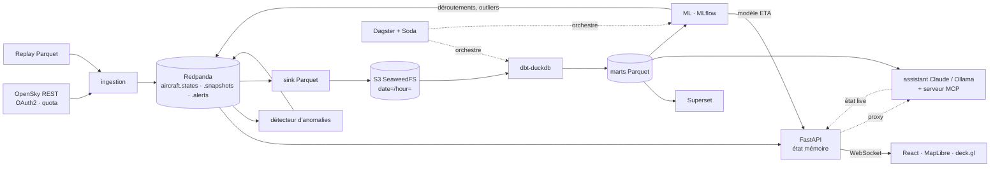
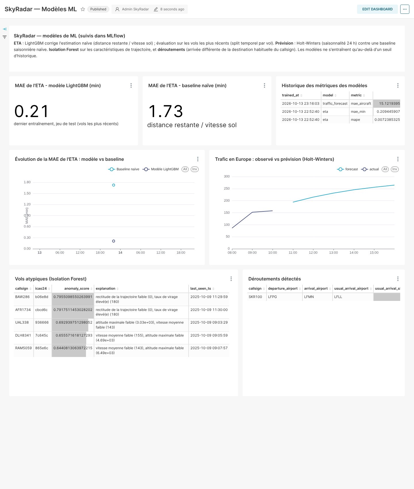
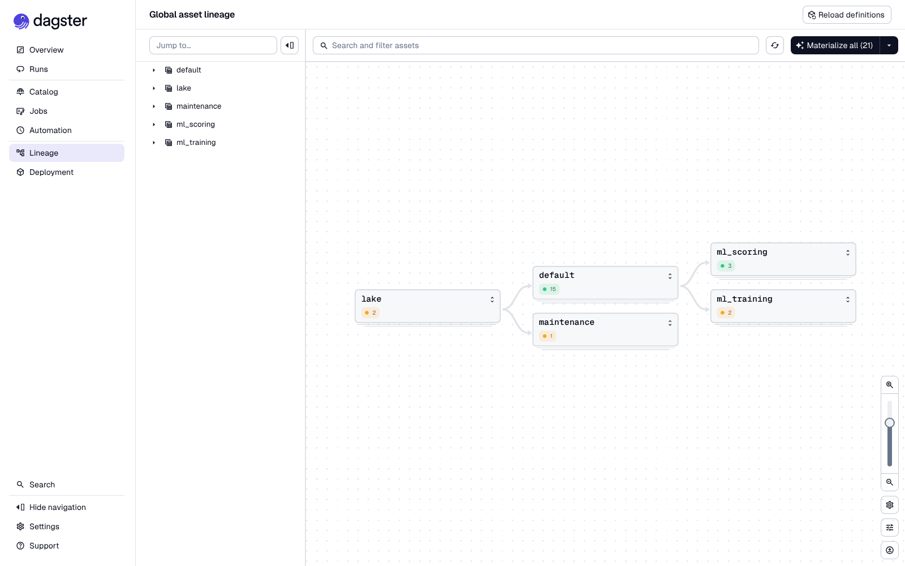

# SkyRadar ✈️ — tous les avions du monde, en temps réel

**SkyRadar affiche en direct les quelque 11 000 avions suivis par le réseau ADS-B OpenSky sur
une carte fluide, et historise chaque position dans un lakehouse (Redpanda → Parquet → dbt →
DuckDB). Ces données alimentent des dashboards, de la détection d'anomalies, des modèles de ML
et un assistant en langage naturel.**
Projet portfolio de bout en bout : ingestion temps réel, streaming, data engineering,
analytics, ML et IA générative.


<sub>Enregistrement réel (14/10/2026, 00 h 25 UTC, accéléré 4,5×) : ~5 000 avions suivis la
nuit européenne, couleur selon l'altitude, recherche d'un vol puis fiche. En journée, la carte
en suit plus de 11 000 ([capture](docs/images/map.png)).</sub>

| Fiche avion + alerte détectée en direct | Mobile |
|---|---|
|  |  |

---

## Sommaire
- [Ce que le projet démontre](#ce-que-le-projet-démontre)
- [Architecture](#architecture)
- [Démarrage rapide](#démarrage-rapide)
- [Composants et choix techniques](#composants-et-choix-techniques)
- [État d'avancement](#état-davancement)
- [Limites connues](#limites-connues)
- [Feuille de route](#feuille-de-route)
- [English summary](#english-summary)

## Ce que le projet démontre

| Domaine | Ce qui est construit |
|---|---|
| **Data engineering temps réel** | Client OpenSky OAuth2 avec **intervalle de polling calculé à partir du quota de crédits**, backoff sur les 429, Redpanda (Kafka), contrats d'événements pydantic, sink Parquet *at-least-once* avec commits d'offsets maîtrisés |
| **Lakehouse & analytics engineering** | Parquet partitionné `date=/hour=` sur stockage S3, **dbt-duckdb** (staging incrémental → intermediate → marts), tests dbt, marts en Parquet pour respecter la contrainte mono-écrivain de DuckDB |
| **Orchestration & qualité** | **Dagster** : lake déclaré en *external assets*, tests dbt et **contrats Soda Core** (fraîcheur, volume, téléportation) exposés en *asset checks*, schedules horaire / quotidien / maintenance, compaction des petits fichiers Parquet |
| **Reconstitution de vols** | Segmentation des trajectoires et rattachement des extrémités à l'aéroport le plus proche (OurAirports), en SQL, car l'ADS-B ne transporte ni origine ni destination |
| **Détection d'anomalies** | En streaming : squawk 7500/7600/7700, descente rapide, **attente / tourne en rond**, **perte de signal en zone couverte** (position extrapolée + couverture des récepteurs). En batch : **déroutements** (destination habituelle du callsign) et vols atypiques (**Isolation Forest** expliqué) |
| **Produit & front** | React + MapLibre + **deck.gl** sur buffers binaires, **interpolation sphérique** des positions, WebSocket au format colonne, responsive |
| **BI** | **Superset** sur DuckDB : dashboards *Trafic aérien* et *Modèles ML* versionnés « as code » et importés au démarrage |
| **Machine learning** | **ETA LightGBM** qui corrige une baseline physique (MAE comparée dans MLflow, barrière de promotion, servie par l'API) ; **prévision du trafic** par zone (Holt-Winters contre naïf saisonnier) ; registry et historique des métriques dans **MLflow** ([ADR 0008](docs/adr/0008-ml-models.md)) |
| **IA générative** | **Assistant en français** : boucle d'outils Claude (text-to-SQL + état en direct) ou modèle local Ollama, **garde-fous** sqlglot (SELECT seul, liste blanche, LIMIT forcé, timeout, DuckDB sans accès fichier), jeu d'évaluation de 20 questions, **serveur MCP** pour Claude Desktop |
| **Industrialisation** | Docker multi-stage, healthchecks, profils compose, Makefile, CI GitHub Actions (lint, typage, tests, `dbt build`, ML et éval de l'assistant sur données de test, build des images, test e2e), [guide de déploiement](docs/deployment.md) (VM + Caddy, ou Cloudflare Pages + Fly.io + Kafka managé) |

## Architecture



Détails : [docs/architecture.md](docs/architecture.md) · protocole temps réel :
[docs/websocket-protocol.md](docs/websocket-protocol.md) · décisions :
[docs/adr/](docs/adr/) · plan : [docs/implementation-plan.md](docs/implementation-plan.md).

## Démarrage rapide

Prérequis : Docker (avec Compose v2), `make`, Python 3 ; [uv](https://docs.astral.sh/uv/) et
Node 22 pour le développement.

```bash
cp .env.example .env      # optionnel : make le fait ; renseigner OPENSKY_CLIENT_ID/SECRET
make seed                 # télécharge les données de référence (OurAirports)
make up                   # stack complète (profil "full")
# ou
make up-demo              # carte en direct uniquement (Redpanda, ingestion, API, frontend)
make replay               # démo hors ligne : rejoue data/replay/replay.parquet (ou trafic synthétique)
```

| URL | Service |
|---|---|
| http://localhost:3000 | Carte en direct |
| http://localhost:8000/docs | API (OpenAPI) |
| http://localhost:3001 | Dagster |
| http://localhost:8088 | Superset (admin / mot de passe du `.env`) |
| http://localhost:5000 | MLflow |
| http://localhost:8081 | Console Redpanda |
| http://localhost:8888/buckets/ | Navigateur du lake (filer SeaweedFS) |

Autres commandes : `make record` (enregistre 30 min de données réelles pour le replay),
`make test`, `make lint`, `make dbt-build` (dbt sur un lake de test déterministe),
`make eval-assistant` (évaluation de l'assistant ; `DRY=1` pour ne vérifier que les requêtes
de référence, sans appel au LLM), `make smoke` (tests e2e sur la stack lancée),
`make logs S=ingestion`, `make down`, `make clean`.

**Sans aucune clé**, tout fonctionne : OpenSky passe en mode anonyme (un snapshot toutes les
16 min, la carte interpole entre deux snapshots) et l'assistant est désactivé proprement
(réponse 503 explicite). Avec `ANTHROPIC_API_KEY` l'assistant utilise Claude ; avec
`OLLAMA_BASE_URL` un modèle local.
**Lancez l'ingestion le plus tôt possible** : la reconstitution des vols et les futurs modèles
de ML s'améliorent avec l'historique accumulé.

### Quota OpenSky : intervalle calculé

Selon la documentation officielle, un appel global à `/states/all` coûte **4 crédits** ; le
quota journalier est de **400** crédits en anonyme, **4 000** avec un compte et **8 000** pour
un feeder actif. Avec 10 % de marge :

| Profil | Intervalle (`POLL_INTERVAL_SECONDS=auto`) | Appels / 24 h | Crédits / 24 h |
|---|---|---|---|
| Anonyme | 960 s | 90 | 360 / 400 |
| Compte (OAuth2) | 96 s | 900 | 3 600 / 4 000 |
| Feeder | 48 s | 1 800 | 7 200 / 8 000 |

Une valeur manuelle trop agressive est automatiquement relevée au minimum sûr. Une bounding
box (`OPENSKY_BBOX`) réduit le coût par appel et donc l'intervalle. Voir
[ADR 0006](docs/adr/0006-opensky-polling.md).

## Composants et choix techniques

| Dossier | Rôle | Choix et compromis |
|---|---|---|
| `libs/common` | Modèles de messages pydantic, Kafka, logging structlog, S3, schémas Arrow | Une seule source de vérité pour les contrats ([ADR 0004](docs/adr/0004-event-contracts.md)) |
| `ingestion/` | `FlightDataSource` (adapter) : `OpenSkySource`, `ReplaySource`, générateur synthétique ; producteur Redpanda ; `/metrics` Prometheus | httpx async ; token OAuth2 mis en cache et renouvelé ; cadence fixe ; replay rebasé sur l'heure courante |
| `api/` | FastAPI : état mémoire, traces, `WS /ws/live`, `/aircraft/{icao24}` (avec départ, destination probable et **ETA**), `/live/region`, `/alerts`, `/stats/live`, proxy `/assistant/ask` | Pas de *consumer group* (vue diffusée à chaque réplique) ; relecture de 20 min au démarrage ; deltas en colonnes, envoyés au plus une fois par seconde ; marts et modèle ETA rechargés à chaud |
| `frontend/` | React, MapLibre (tuiles OpenFreeMap, sans clé), deck.gl | Store hors React, `IconLayer` sur `Float32Array`, *dead reckoning* + fondu de correction ; nginx sert le build et proxifie `/api` (aucun secret côté navigateur) |
| `streaming/` | `parquet_sink` et `anomaly` | At-least-once + noms de fichiers déterministes ([ADR 0005](docs/adr/0005-sink-delivery-semantics.md)) ; règles pures et testées unitairement ; la perte de signal attend deux snapshots manquants et ne s'active qu'avec un polling authentifié (calibrée sur données réelles) |
| `pipeline/dbt` | staging → intermediate → marts, features ML | 15 modèles, marts en Parquet externes, dbt seul écrivain ([ADR 0003](docs/adr/0003-duckdb-single-writer.md)) ; aucun package dbt externe (tests génériques maison), donc build hors ligne ; filtrage des positions aberrantes (« téléportations » ADS-B) avant la segmentation des vols |
| `pipeline/dagster` | Assets dbt, asset checks dbt + Soda, assets ML (entraînement quotidien, scoring horaire), compaction | `QueuedRunCoordinator` limité à 1 run (DuckDB mono-écrivain) ; métadonnées dans Postgres |
| `data_quality/` | Contrats **Soda Core** v4 (`raw_aircraft_states`, `fct_flights`) | Déclaratifs, exécutés sur une connexion DuckDB en mémoire ([ADR 0007](docs/adr/0007-data-quality-tool.md)) |
| `ml/` | ETA, prévision de trafic, Isolation Forest, qualité de la reconstitution | Seuils d'historique (`skipped` tant que les données manquent), baseline systématique, écriture atomique des sorties, tracking MLflow non bloquant ([ADR 0008](docs/adr/0008-ml-models.md)) |
| `assistant/` | Boucle d'outils Claude (*tool runner* du SDK Anthropic) ou Ollama, garde-fous SQL, serveur MCP, jeu d'évaluation | Défense en profondeur : parsing sqlglot + liste blanche + `LIMIT` + DuckDB `enable_external_access=false` + timeout ; le LLM ne voit que des outils ([docs/mcp.md](docs/mcp.md)) |
| `dashboards/` | Dashboards Superset « as code » (`build_dashboards.py`) exportés en YAML | Versionnés, diffables, importés automatiquement au démarrage de Superset |
| `deploy/` | Caddy, surcharge compose de production, configurations Fly.io | Voir [docs/deployment.md](docs/deployment.md) |
| `infra/` | Images MLflow et Superset, init Postgres | Une instance Postgres, une base par outil |

Stockage objet : **SeaweedFS** (compatible S3) remplace MinIO, qui ne publie plus d'images
Docker communautaires ([ADR 0002](docs/adr/0002-object-storage-seaweedfs.md)). Le code reste
générique S3.

### Dashboards Superset


<sub>*Trafic aérien*, sur les données réelles après quelques minutes d'ingestion : le trafic
par zone, les pays et les altitudes sont alimentés tout de suite ; les tableaux de vols,
d'aéroports et de routes se remplissent après quelques heures d'historique.</sub>


<sub>*Modèles ML* : MAE de l'ETA contre la baseline, historique des métriques, trafic observé
et prévu, vols atypiques, déroutements. **Capture sur le lake de test synthétique** (les
modèles ne s'entraînent sur les données réelles qu'après assez d'historique) : ces chiffres
illustrent le dashboard, pas la performance en conditions réelles.</sub>

### Orchestration


<sub>Groupes d'assets Dagster : lake brut → modèles dbt (avec 67 asset checks dbt et Soda,
tous verts sur les données réelles) → scoring ML horaire, entraînement quotidien, et
maintenance (compaction du lake).</sub>

## État d'avancement

Le projet a été construit en trois étapes : **squelette → tranche verticale → enrichissement**
(voir le [plan](docs/implementation-plan.md)). Les trois sont faites ; tout ce qui suit a été
vérifié sur la stack lancée avec de vraies données OpenSky, sauf mention contraire.

| Critère d'acceptation | État |
|---|---|
| `make up` / `make up-demo` démarrent sans erreur | ✅ tous les services *healthy* |
| Milliers d'avions réels, fluides, fiche + trace au clic | ✅ ~11 000 avions OpenSky, interpolation, fiche (départ, destination probable, ETA), trace |
| Quota OpenSky jamais dépassé sur 24 h | ✅ intervalle calculé, testé, documenté |
| Positions historisées en Parquet partitionné sur S3 | ✅ (SeaweedFS au lieu de MinIO, voir ADR 0002) ; compaction quotidienne des petits fichiers (un fichier par heure) |
| `dbt build` passe, marts visibles dans Superset | ✅ 15 modèles et 53 tests dbt (lake de test et données réelles) ; 2 dashboards (16 graphiques) |
| Dagster orchestre dbt, qualité et ML | ✅ assets dbt + 67 asset checks (53 tests dbt + 14 checks Soda Core) + assets ML + compaction ; 3 schedules |
| Alertes squawk et attente en cercle en direct sur la carte | ✅ (+ descente rapide, perte de signal, déroutement, vol atypique) |
| Modèles suivis dans MLflow avec baseline | ✅ ETA LightGBM vs distance / vitesse, prévision Holt-Winters vs naïf saisonnier, Isolation Forest ; 🟡 vérifié sur le lake de test, sur données réelles ils attendent l'historique minimal |
| Assistant en français, lecture seule, garde-fous | ✅ boucle d'outils Claude ou Ollama, garde-fous testés, serveur MCP ; 🟡 éval des 20 questions vérifiée côté requêtes de référence (`DRY=1`), l'éval complète demande une clé API |
| Démo complète sans OpenSky (replay) | ✅ `make replay` (fichier enregistré ou trafic synthétique) |
| CI verte, README complet | ✅ workflow lint / types / tests / dbt / ML / éval / images / e2e |

## Limites connues

- **Couverture ADS-B** : excellente au-dessus de l'Amérique du Nord et de l'Europe, faible
  au-dessus des océans, de l'Afrique et d'une partie de l'Asie (réseau de récepteurs au sol
  bénévoles). Les « trous » de trajectoire découpent parfois un vol en deux.
- **Pas d'origine ni de destination dans les données** : elles sont **reconstituées**
  (aéroport le plus proche d'une extrémité basse). Un vol qui sort de la couverture avant
  l'atterrissage n'a pas d'arrivée.
- **Quota de l'API** : en anonyme, un snapshot toutes les 16 minutes ; l'interpolation est
  alors une extrapolation qui ignore les virages. Un compte gratuit ramène l'intervalle à 96 s.
- **Données** : OpenSky Network, **usage non commercial et recherche uniquement**
  (<https://opensky-network.org/about/terms-of-use>). Les fichiers enregistrés ne sont pas
  redistribués dans ce dépôt.
- La réécriture horaire d'un mart peut faire échouer une requête qui la chevauche (voir ADR 0003).
- **Perte de signal** : en mode anonyme (un snapshot toutes les 16 min), un avion disparu a
  très souvent simplement atterri ; rejouée sur des données réelles, la règle produisait plus
  de 150 alertes par snapshot. Elle ne s'active donc qu'avec un polling authentifié (96 s ou
  48 s) et n'a pas encore pu être observée sur données réelles à cette cadence.
- **Modèles** : les métriques publiées ici viennent du lake de test ; sur données réelles,
  l'ETA dépend de la qualité de la reconstitution (arrivées manquantes hors couverture).

## Feuille de route

1. Reconstitution des vols : clustering DBSCAN des extrémités sans aéroport proche.
2. Enrichissement avec la base aéronefs OpenSky (type, compagnie) et dashboards
   supplémentaires (compagnies, ponctualité).
3. Features météo (vent en altitude) pour l'ETA ; prévision par aéroport.
4. Éval de l'assistant suivie dans MLflow à chaque changement de prompt ou de modèle.

---

## English summary

**SkyRadar** is an end-to-end, real-time flight tracking platform built as a data portfolio
project. It ingests live ADS-B state vectors from the OpenSky Network (OAuth2 client
credentials, with a polling interval **derived from the daily credit quota**: 960 s anonymous,
96 s registered, 48 s feeder) and publishes them to **Redpanda**. Downstream:

- a **FastAPI** service keeps the live state in memory and streams column-oriented deltas over
  WebSocket to a **React + MapLibre + deck.gl** map, which renders 11k+ aircraft with
  spherical dead-reckoning interpolation; the aircraft panel shows the departure airport,
  the probable destination and an **ETA**;
- a streaming **anomaly detector** raises emergency squawk, rapid-descent, holding-pattern
  and signal-loss alerts (the latter calibrated on real data: it waits for two missing
  snapshots and only runs with authenticated polling);
- an at-least-once **Parquet sink** lands every position in an S3 lake (SeaweedFS, since MinIO
  no longer ships community images), modelled with **dbt-duckdb** (15 models: incremental
  staging, ADS-B glitch filtering, flight reconstruction, marts and ML features written as
  Parquet to respect DuckDB's single-writer constraint) and orchestrated by **Dagster**
  (dbt tests and **Soda Core** contracts as asset checks, hourly scoring, daily training,
  lake compaction);
- **ML**, tracked in **MLflow** against explicit baselines: a LightGBM ETA model that learns a
  correction of the physics baseline (served by the API only if it beats it), Holt-Winters
  traffic forecasting vs seasonal naive, an explained Isolation Forest and diversion
  detection, both published as alerts;
- **Superset** dashboards (traffic, ML models) are versioned as code;
- a French-speaking **assistant** runs a Claude tool loop (or a local Ollama model) over
  guarded text-to-SQL (sqlglot allow-listing, forced LIMIT, timeout, sandboxed read-only
  DuckDB) and live-state tools, with a 20-question eval set and an **MCP server** for
  Claude Desktop.

Quick start: `cp .env.example .env && make seed && make up` (or `make up-demo`, or `make
replay` for a fully offline demo). Everything runs without any API key (the assistant is then
disabled cleanly). Deployment: [docs/deployment.md](docs/deployment.md). Status: all three
stages (skeleton, vertical slice, enrichment) are done and verified on real data; model
metrics shown come from the deterministic test lake until enough real history accumulates.

OpenSky data is for **non-commercial / research use only**.
