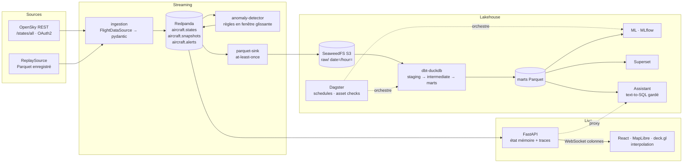

# Architecture

## Flux temps réel

1. **ingestion** interroge la source à l'intervalle calculé à partir du quota (ADR 0006),
   valide chaque *state vector* (pydantic), écarte les lignes sans position, ajoute
   `ingested_at`, puis publie un message par avion (clé `icao24`) suivi d'un message de
   métadonnées de snapshot. Métriques Prometheus sur `:9100/metrics`.
2. **API** lit les trois topics sans *consumer group* (chaque réplique voit tout), recule de
   20 minutes au démarrage (`offsets_for_times`) pour afficher immédiatement la carte, garde la
   dernière position et une trace de 120 points par avion, et évince les avions absents depuis
   `max(300 s, 2,5 × intervalle)`.
3. **WebSocket** : snapshot complet puis deltas au format colonne (voir
   [websocket-protocol.md](websocket-protocol.md)).
4. **Frontend** : le store vit hors de React ; chaque frame (20 fps) calcule les positions
   interpolées (*dead reckoning* sphérique à partir de la vitesse et du cap, plafonné à 20 min)
   dans des buffers binaires passés directement à l'`IconLayer` de deck.gl. Quand un nouveau
   fix arrive, l'écart avec la position affichée est résorbé en 3 s, ce qui évite les sauts.

## Flux analytique

1. **parquet-sink** : Parquet zstd, partitions `date=/hour=` (heure de l'événement), schéma
   Arrow explicite (`skyradar_common.parquet`), commit des offsets après écriture (ADR 0005).
2. **dbt** (orchestré par Dagster, toutes les heures à hh:05) :
   - `stg_aircraft_states` (incrémental, retraite les 3 dernières heures de partitions) :
     typage, bornes, dédoublonnage ;
   - `int_flight_segments` : un nouveau vol commence après un trou de plus de 30 min ou au
     décollage ;
   - `int_flight_endpoints` : aéroport le plus proche (grille de 0,5° puis haversine) si
     l'extrémité est au sol ou sous 1 500 m, à moins de 15 km ;
   - marts `fct_flights`, `fct_traffic_hourly`, `fct_airport_activity`, `fct_routes`,
     `fct_alerts_history`, `fct_altitude_profile`, écrits en Parquet (ADR 0003).
3. **Dagster** : le lake brut est déclaré en *external assets* ; les tests dbt deviennent des
   *asset checks*, complétés par un check de fraîcheur ; l'asset ML
   `flight_reconstruction_quality` est loggué dans MLflow.

## Services et ports

| Service | Profil | Port |
|---|---|---|
| frontend (nginx + proxy `/api`) | demo, full | 3000 |
| api (FastAPI, `/docs`) | demo, full | 8000 |
| ingestion (`/metrics`) | demo, full | 9100 |
| redpanda (Kafka externe) | demo, full | 19092 |
| anomaly-detector | demo, full | — |
| redpanda-console | full | 8081 |
| object-store (S3 / filer) | full | 8333 / 8888 |
| parquet-sink | full | — |
| postgres (métadonnées) | full | — |
| dagster-webserver / daemon | full | 3001 |
| mlflow | full | 5000 |
| superset | full | 8088 |
| assistant | full | interne (8001) |
