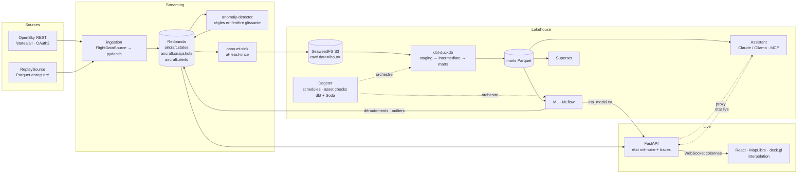

# Architecture

## Flux temps réel

1. **ingestion** interroge la source à l'intervalle calculé à partir du quota (ADR 0006),
   valide chaque *state vector* (pydantic), écarte les lignes sans position, ajoute
   `ingested_at`, puis publie un message par avion (clé `icao24`) suivi d'un message de
   métadonnées de snapshot. Métriques Prometheus sur `:9100/metrics`.
2. **API** lit les trois topics sans *consumer group* (chaque réplique voit tout), recule de
   20 minutes au démarrage (`offsets_for_times`) pour afficher immédiatement la carte, garde la
   dernière position et une trace de 120 points par avion, et évince les avions absents depuis
   `max(300 s, 2,5 × intervalle)`.
3. **WebSocket** : snapshot complet puis deltas au format colonne (voir
   [websocket-protocol.md](websocket-protocol.md)).
4. **Frontend** : le store vit hors de React ; chaque frame (20 fps) calcule les positions
   interpolées (*dead reckoning* sphérique à partir de la vitesse et du cap, plafonné à 20 min)
   dans des buffers binaires passés directement à l'`IconLayer` de deck.gl. Quand un nouveau
   fix arrive, l'écart avec la position affichée est résorbé en 3 s, ce qui évite les sauts.
5. **Vue aéroport** (`GET /airports`, `GET /airports/{icao}/board`) : les aéroports viennent
   de `dim_airports`, ou directement du fichier OurAirports dans le profil `demo`. Le tableau
   ne considère que les avions du dernier snapshot : au sol à moins de 6 km, ou en vol et
   liés à l'aéroport (moins de 150 km, décollage observé, destination habituelle du
   callsign, route publiée déjà en cache). Leur route est résolue comme pour la fiche avion
   (décollage observé, route publiée vérifiée contre la position, historique) ; les routes
   des avions à moins de 150 km sont cherchées dans adsbdb, les plus proches d'abord, avec
   un budget par requête et un plafond global. Sans route, un avion bas (< 3 500 m) à moins
   de 60 km qui descend vers l'aéroport est une arrivée, un avion qui monte en s'en
   éloignant un départ. Les 24 dernières heures viennent de `fct_flights`.
6. **Météo d'aéroport** (`GET /airports/{icao}/weather`) : dernier METAR de l'aéroport
   (aviationweather.gov, NOAA, sans clé), mis en cache 10 min par aéroport et décodé par
   l'API (température, vent, visibilité, plafond, temps présent en français, catégorie
   VFR / IFR). Affichée dans le filtre aéroport et le tableau ; `WEATHER_LOOKUP=off` la coupe.

## Flux analytique

1. **parquet-sink** : Parquet zstd, partitions `date=/hour=` (heure de l'événement), schéma
   Arrow explicite (`skyradar_common.parquet`), commit des offsets après écriture (ADR 0005).
2. **dbt** (orchestré par Dagster, toutes les heures à hh:05) :
   - `stg_aircraft_states` (incrémental, retraite les 3 dernières heures de partitions) :
     typage, bornes, dédoublonnage ;
   - `int_flight_segments` : les positions aberrantes isolées (vitesse implicite > 600 m/s
     vers les deux voisines) sont écartées ; un nouveau vol commence après un trou de plus
     de 30 min, au décollage, ou après un saut impossible ;
   - `int_flight_endpoints` : aéroport le plus proche (grille de 0,5° puis haversine) si
     l'extrémité est au sol ou sous 1 500 m, à moins de 15 km ;
   - référentiels (`make seed`, optionnels) : OurAirports, base aéronefs OpenSky et types
     OACI (`dim_aircraft_registry`, `dim_aircraft`), compagnies OpenFlights
     (`dim_airlines`, `fct_airline_activity`) ; vent à 250 hPa d'Open-Meteo
     (`stg_upper_winds`, `fct_upper_winds`) ;
   - marts `fct_flights` (avec compagnie et type d'avion), `fct_traffic_hourly`,
     `fct_airport_activity`, `fct_routes`, `fct_alerts_history`, `fct_altitude_profile`,
     `fct_callsign_routes`, `fct_diversions`, `dim_airports`, et features
     `ml_eta_features` (dont le vent arrière) / `ml_flight_features` /
     `ml_unmatched_endpoints`, écrits en Parquet (ADR 0003).
3. **Dagster** (ADR 0007, 0008) :
   - le lake brut est déclaré en *external assets* ; les tests dbt et les contrats Soda Core
     deviennent des *asset checks* ;
   - `dbt_hourly` (hh:05) : vent en altitude (`lake/upper_winds`, une récupération par
     jour), dbt, checks, puis scoring ML (`traffic_forecast`, `trajectory_outliers`,
     `endpoint_clusters`, `diversion_alerts`) ; les déroutements et vols atypiques
     récents sont publiés sur `aircraft.alerts` ;
   - `ml_daily` (03:30) : `eta_model` et `flight_reconstruction_quality`, loggués dans
     MLflow ; le modèle ETA promu est écrit dans le volume des marts, que l'API recharge ;
   - `lake_maintenance` (02:15) : compaction des partitions closes en un fichier par heure,
     puis rétention : partitions brutes de plus de `LAKE_RETENTION_DAYS` jours (30)
     supprimées. `stg_aircraft_states` garde son propre historique, plus long
     (`WAREHOUSE_HISTORY_DAYS`, 180 jours, *post-hook* dbt) ; les deux durées sont comptées
     depuis la donnée la plus récente, jamais depuis l'horloge.

## Supervision

Chaque service expose des métriques Prometheus (ingestion `:9100`, parquet-sink `:9101`,
anomaly-detector `:9102`, API `/metrics/`, Redpanda `/public_metrics`). Prometheus
(profil `full`) les collecte toutes les 15 s et évalue les règles d'`infra/monitoring/rules.yml`
(testées par `promtool test rules`), envoyées à Alertmanager ; Grafana affiche le dashboard
provisionné *SkyRadar — Supervision*. Côté API : avions en mémoire, clients WebSocket, âge
du dernier snapshot, état de la connexion à Redpanda, requêtes par route et statut, refus
des limites de débit, recherches de routes adsbdb.

## Assistant

`POST /assistant/ask` (proxifié par l'API) → boucle d'outils : Claude via le *tool runner*
du SDK Anthropic, ou un modèle Ollama. Outils : `run_sql` (SELECT DuckDB sur les marts,
garde-fous sqlglot, `LIMIT` forcé, timeout, accès fichier désactivé), `get_live_stats`,
`count_live_aircraft`, `get_active_alerts` (état en direct via l'API). Les mêmes outils sont
exposés par un serveur MCP ([mcp.md](mcp.md)).

## Services et ports

| Service | Profil | Port |
|---|---|---|
| frontend (nginx + proxy `/api`) | demo, full | 3000 |
| api (FastAPI, `/docs`) | demo, full | 8000 |
| ingestion (`/metrics`) | demo, full | 9100 |
| redpanda (Kafka externe) | demo, full | 19092 |
| anomaly-detector | demo, full | — |
| redpanda-console | full | 8081 |
| object-store (S3 / filer) | full | 8333 / 8888 |
| parquet-sink | full | — |
| postgres (métadonnées) | full | — |
| dagster-webserver / daemon | full | 3001 |
| mlflow | full | 5000 |
| superset | full | 8088 |
| assistant | full | interne (8001) |
| prometheus / alertmanager | full | 9090 / interne (9093) |
| grafana | full | 3002 |
