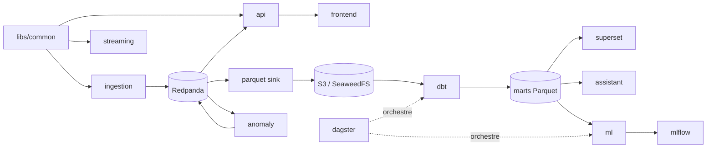

# Plan d'implémentation — SkyRadar

Ce document décrit l'ordre de construction, les fichiers créés à chaque étape et les
dépendances entre briques. Il est tenu à jour au fil du projet (cases cochées).

## Principes

- **Toujours démarrable** : chaque étape se termine par `make up` (ou `make up-demo`)
  qui passe, les tests unitaires verts et un smoke test.
- **Données d'abord** : l'ingestion et le sink Parquet sont livrés dans la tranche
  verticale pour accumuler de l'historique (prérequis des modèles ML).
- **Une seule source de vérité pour les schémas** : les modèles pydantic de
  `libs/common` définissent les messages Redpanda ; le sink Parquet, le dbt et le
  frontend en dérivent.
- **Monorepo Python en workspace `uv`** : un package par service, un seul lockfile,
  images Docker minimales (`uv sync --package <service>`).

## Calcul de l'intervalle de polling OpenSky

Source : documentation officielle OpenSky REST API (section *API credit usage*).

| Élément | Valeur |
|---|---|
| Coût d'un appel `/states/all` global (> 400 deg²) | 4 crédits |
| Quota journalier anonyme | 400 crédits |
| Quota journalier compte standard (OAuth2) | 4 000 crédits |
| Quota journalier feeder actif | 8 000 crédits |
| Résolution temporelle | 10 s (anonyme), 5 s (authentifié) |

Formule (marge de sécurité `m`, 10 % par défaut) :

```
intervalle = ceil( 86400 × coût_par_appel / (quota_journalier × (1 − m)) )
```

| Profil | Appels/jour possibles | Intervalle calculé (m = 10 %) |
|---|---|---|
| Anonyme | 100 | **960 s** (16 min) |
| Standard | 1 000 | **96 s** |
| Feeder | 2 000 | **48 s** |

`POLL_INTERVAL_SECONDS=auto` (par défaut) applique ce calcul ; une valeur numérique
est acceptée mais **relevée au minimum sûr** si elle ferait dépasser le quota.
Une bounding box (`OPENSKY_BBOX`) réduit le coût par appel (1 à 3 crédits) et donc
l'intervalle. L'en-tête `X-Rate-Limit-Remaining` est logué à chaque appel ; un 429
déclenche un backoff exponentiel qui respecte `X-Rate-Limit-Retry-After-Seconds`.

## Étape 1 — Squelette (tout démarre avec `make up`)

- [x] Racine : `pyproject.toml` (workspace uv), `Makefile`, `.env.example`,
  `.gitignore`, `.pre-commit-config.yaml`, `docker-compose.yml` (profils `demo`/`full`).
- [x] `libs/common` : modèles de messages, config Kafka, logging structlog, accès S3.
- [x] Un `Dockerfile` multi-stage par service, healthchecks, `depends_on` conditionnels.
- [x] Services d'infrastructure : Redpanda (+ console), SeaweedFS (S3), Postgres
  (métadonnées Dagster / Superset / MLflow), MLflow, Superset, Dagster.
- [x] `docs/adr/` : décisions structurantes.

## Étape 2 — Tranche verticale de bout en bout

Flux temps réel :

- [x] `ingestion/` : `FlightDataSource` (interface), `OpenSkySource` (OAuth2 + quota +
  backoff), `ReplaySource` (Parquet), producteur Redpanda, `/metrics`.
- [x] `api/` : consommateur `aircraft.states` / `aircraft.snapshots` / `aircraft.alerts`,
  état en mémoire + traces, `WS /ws/live` (format colonne), REST.
- [x] `frontend/` : carte MapLibre sombre + deck.gl, interpolation, fiche avion, alertes.

Flux historique et analytique :

- [x] `streaming/parquet_sink` : Parquet partitionné `date=/hour=` dans le bucket S3.
- [x] `streaming/anomaly` : règles squawk 7500/7600/7700, descente rapide, attente en
  hippodrome → topic `aircraft.alerts`.
- [x] `pipeline/dbt` : staging → intermediate → marts (Parquet externes).
- [x] `pipeline/dagster` : assets dbt + schedule horaire.
- [x] `dashboards/` : bootstrap Superset + export versionné.
- [x] `scripts/` : `seed_reference_data.py`, `record_replay.py`,
  `generate_synthetic_replay.py`.
- [x] Tests unitaires, smoke test d'intégration, CI GitHub Actions, README.

## Étape 3 — Enrichissement (itérations suivantes)

1. **Qualité des données** : checks Soda Core (fraîcheur, volume, téléportation)
   exposés comme asset checks Dagster.
2. **Reconstitution des vols** : dbt incrémental, clustering DBSCAN des fins de vol
   sans aéroport proche, métrique de couverture départ/arrivée dans MLflow.
3. **Anomalies** : perte de signal en vol, déroutement (destination habituelle du
   callsign), Isolation Forest sur features de trajectoire (scoring Dagster).
4. **ETA** : features + LightGBM vs baseline distance/vitesse (MAE, MAPE), seuil
   d'historique, endpoint de scoring dans l'API.
5. **Prévision de trafic** : Prophet/statsmodels par zone vs baseline saisonnière.
6. **Assistant** : text-to-SQL Anthropic (ou Ollama), garde-fous sqlglot, outil
   « état live », jeu d'évaluation (~20 questions), serveur MCP.
7. **Dashboards** : 7 dashboards Superset demandés, dont la performance ETA.
8. **Déploiement** : guides Fly.io / Render + Cloudflare Pages pour le profil `demo`.

## Dépendances entre briques


